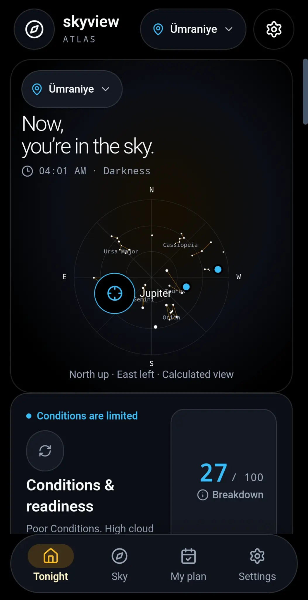
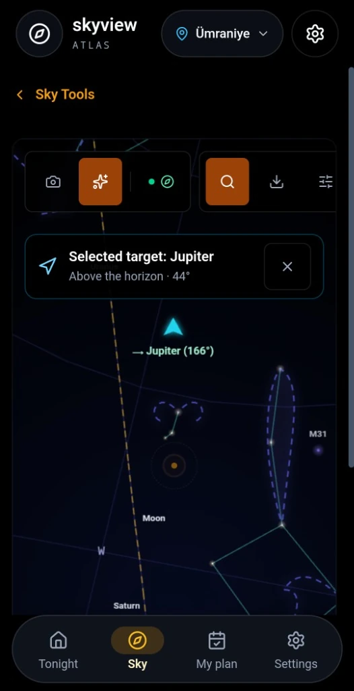
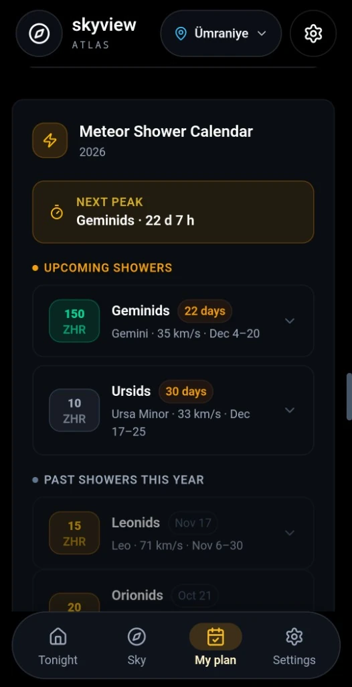

<div align="center">
  
  <h1>SkyView · Moon &amp; Space Tracker</h1>
  <p><strong>Check the sky, plan your night, and find your next target.</strong></p>
  <p>An Android and web astronomy app with a sky atlas, local observing forecasts, and AR guidance.</p>
  <p>
    
    
    <a href="LICENSE"></a>
  </p>
  <p><a href="#app-preview">App preview</a> · <a href="#features">Features</a> · <a href="#getting-started">Getting started</a> · <a href="#android-build">Android build</a></p>
</div>

## App preview

<table>
  <thead>
    <tr>
      <th scope="col" align="center">Tonight</th>
      <th scope="col" align="center">Sky compass</th>
      <th scope="col" align="center">Meteor calendar</th>
    </tr>
  </thead>
  <tbody>
    <tr>
      <td align="center"><a href="assets/readme/tonight.webp"></a></td>
      <td align="center"><a href="assets/readme/sky-compass.webp"></a></td>
      <td align="center"><a href="assets/readme/meteor-calendar.webp"></a></td>
    </tr>
  </tbody>
</table>

The *Skylook Company Presentation* calls the first two views “Readiness Index & Calculated Polar Radar” and “Real-Time Celestial Compass” (slides 3–4). The compass and meteor calendar images come from slides 4–5. Select any image to open it at full size.

**Example.** In the Ümraniye screenshot, Jupiter is marked on the atlas while local observing conditions score **27/100**. Open the score breakdown to see what contributed, then move the time slider to compare later hours. Add a target to **My plan** or open the sky compass to find it in the field.

## Features

| Area | What you can do |
| --- | --- |
| **Tonight** | View the sky from your chosen location and time. Check hourly clouds, moonlight, and the observing score. |
| **Sky** | Find planets, stars, constellations, and deep-sky objects. Follow azimuth and altitude in the sky compass and enable the camera overlay on compatible devices. |
| **My plan** | Build an equipment-aware route, compare seven nights of forecasts, check the Moon and meteor calendars, and keep an observation journal. |
| **Satellites** | Follow the ISS ground track, check upcoming passes, and inspect the orbits of selected satellites. |
| **Field tools** | Switch to red-light mode, inspect the light-pollution map, and check available cached readings when offline. Android adds local alarms, haptic guidance, and a red-light Quick Settings tile. |
| **NASA APOD** | Browse NASA’s Astronomy Picture of the Day and save favorites. |

The app supports English, Turkish, German, French, Spanish, Italian, Portuguese, and Arabic, with right-to-left layout for Arabic. Bortle classes shown in the app are estimates.

## Getting started

Use **Node.js 22.12 or later** and npm. After cloning or downloading the repository, run these commands from its root.

```sh
npm ci
npm run dev
```

Open <http://localhost:3000>. NASA APOD uses `DEMO_KEY` by default. To use your own key for local development, copy [`.env.example`](.env.example) to `.env` and set `VITE_NASA_API_KEY`. Vite embeds `VITE_` values in the client bundle, so use a key intended for client exposure.

## Android build

Use **JDK 21** and **Android SDK Platform 36**. For command-line builds, set `JAVA_HOME` to your JDK and pass that path to Gradle if the checked-in Windows JDK path is unavailable.

```sh
npm run build
npx cap sync android
npx cap open android
```

Run the app from Android Studio on a device or emulator. You can also build a debug APK from the `android/` directory using the Gradle wrapper.

| Shell | Command |
| --- | --- |
| macOS or Linux | `./gradlew -Dorg.gradle.java.home="$JAVA_HOME" :app:assembleDebug` |
| Windows PowerShell | `.\gradlew.bat "-Dorg.gradle.java.home=$env:JAVA_HOME" :app:assembleDebug` |

The resulting APK is written to `android/app/build/outputs/apk/debug/app-debug.apk`.

## Project structure

| Path | Responsibility |
| --- | --- |
| [`src/features/`](src/features) | React and TypeScript screens for the atlas, AR, observation planning, satellites, and settings. |
| [`src/workers/`](src/workers) | Astronomy Engine calculations for target suggestions and event searches, run in a web worker. |
| [`src/services/`](src/services) and [`src/repositories/`](src/repositories) | External data clients, on-device persistence, and offline caches. |
| [`android/`](android) | Capacitor host app and native integrations for sensors, notifications, and Android Quick Settings. |

Three.js handles the WebGL sky view, Leaflet renders maps, and satellite.js propagates orbital elements.

**Data and imagery.** Open-Meteo provides forecasts and city search. CelesTrak, Where The ISS At?, and Pollux Labs provide satellite and ISS data. NASA APOD and NASA EOSDIS GIBS provide astronomy imagery and night-light tiles. Map and location data use OpenStreetMap, CARTO, and Nominatim. NOAA SWPC provides the Kp index.

## Development checks

```sh
npm run lint     # ESLint and TypeScript
npm test         # Vitest suite
npm run build    # Web production bundle
```

The [CI workflow](.github/workflows/ci.yml) runs these web checks. See the [contribution guide](CONTRIBUTING.md) for development conventions and [HISTORY.md](HISTORY.md) for project history.

## License

SkyView source code is released under the [MIT License](LICENSE).
